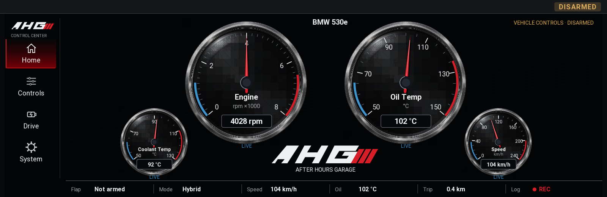

# AHG Control Center

Native BMW MGU / iDrive 7 dashboard built with the existing [idrive7-apps kit](https://github.com/cauliflowermossgrape/idrive7-apps). Uses the kit's Node 8 runtime, native graphics, touch targets and iDrive focus; no browser or WebView on the car.

**Version 1.2.0 adds drive logging, a real-data Drive page and a UI cleanup.** Control testing (from 1.1.x) is unchanged: Stock MG1 exhaust flap and ambient colour slots have real providers behind a session Arm button. Every switch works in simulation; stock ASD and start-stop memory have no verified vehicle provider. See [control testing](docs/CONTROL_TESTING.md) and [capabilities](docs/CAPABILITIES.md). Physical vehicle validation is pending. This app does not flash firmware, enable SSH or obtain SSH keys. The separate Windows installer is a different project.



The reference design is rebuilt as functional widgets: metal instrument faces, independently animated needles, digital readings, left navigation, glossy cards, Hybrid and System pages. It is adapted to the MGU's wider 1920×720 screen and reserved native HMI areas; it is not a pixel-for-pixel copy of the supplied 16:9 mockup. Artwork is illustrative; it is not a photograph of the owner's car.

## Install

Download **AHG-Control-Center-1.2.0-Store.zip** from [Releases](https://github.com/dinerboy/ahg_mgu/releases). See [INSTALL](docs/INSTALL.md) for USB and GitHub source installation through the existing MGU Store. Requires an already supported, provisioned ID7 MGU with MGU Store and a compatible stock BMW donor SDK. The recommended GPU renderer is supplied separately by the upstream toolkit. This package does not install or update it.

## Run the emulator

Use Node 18+ for desktop tooling and Python 3.12 (the app itself targets Node 8.16.2):

```sh
npm ci
npm test
npm run emulator
```

Open http://localhost:8077. Stop the emulator before building a release because its file watcher shares the staging directory. Synthetic demo data is clearly labeled. On-car defaults are read-only with demo off; missing signals show unavailable.

```sh
python kit/tools/build.py --store-package ahg_control_center
npm run package
```

`npm run package` runs tests, builds the SDK-free OAP archive and verifies its contents. Output: `dist/ahg_control_center@1.2.0.tgz`, a USB catalog ZIP and SHA-256 checksums. No proprietary BMW SDK is redistributed. MGU Store supplies the owner's donor SDK during installation, as supported by its [publishing documentation](https://github.com/robertnisipeanu/mgu-store/blob/main/docs/publishing.md).

## What works

- **Home:** four live gauges. Defaults are RPM, oil, coolant and speed, the signals the car actually provides. Boost and 12 V can still be picked but are demo-only.
- **Drive:** live speed/RPM/oil/coolant tiles, this drive's distance, time and maximums, and the last three saved drives. In demo mode this page shows the Hybrid mock-up instead.
- **Drive logging:** live readings are written to `data/drive-logs/drive-*.csv` (1, 2 or 5 samples/s). It runs while other screens are shown, keeps the newest 20 files (20 MB cap each), and saves a summary when you press *Save & New Drive* or 10 minutes after live data stops.
- **Controls:** Engine Config MG1 Open/Closed/OEM with a session Arm, fresh-RPM close guard and OEM hand-back. Ambient colour slots: the highlighted preset is the one the car confirms. ASD and start-stop show as unavailable on stock software instead of fake switches.
- **System:** live-signal count, logging state, saved log storage, a paged app log and signal viewer, and a diagnostics export.
- Stale detection, unavailable states and bounded needle movement. Needle damping now follows real frame time, so needles keep up under the software renderer.
- Hybrid, boost and voltage readings are still demo-only until a verified source is supplied. Vehicle fault status is not scanned.

See [capabilities and limitations](docs/CAPABILITIES.md), [validation](docs/VALIDATION.md), and [provenance/licenses](docs/PROVENANCE.md). [Controls](screenshots/02-controls.png) · [Drive](screenshots/03-drive.png) · [System](screenshots/04-system.png).
