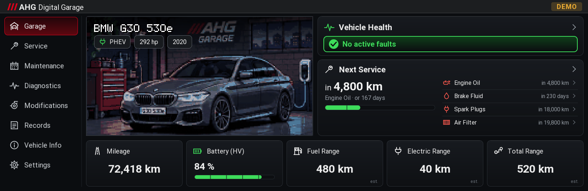

# AHG Digital Garage 0.1.0

A second app next to AHG Control Center, focused on the car's condition rather than live driving data: service due dates, vehicle health, a read-only fault memory scan, modifications and a history of everything done to the car. It uses the same kit and is installed the same way (MGU Store, USB or GitHub source), as `ahg_digital_garage`.



## Install from MGU Store

Add `https://github.com/dinerboy/ahg_mgu` as a GitHub source in MGU Store and select **Releases**, then **AHG Digital Garage** (`ahg_digital_garage`, version 0.1.0). This app has its own ID and data folder and installs alongside AHG Control Center.

Release: [AHG Digital Garage 0.1.0](https://github.com/dinerboy/ahg_mgu/releases/tag/digital-garage-v0.1.0).

For USB installation, extract `AHG-Digital-Garage-0.1.0-Store.zip` onto the USB drive so `mgu-repo/AHG-Digital-Garage/catalog.json` is present. Select that USB source in MGU Store. The `.tgz` release asset is the installable app; the original `AHG-Digital-Garage-0.1.0.zip` also includes Claude's source patch and screenshots.

For a source build, choose the `main` branch or tag `digital-garage-v0.1.0`, then select **AHG Digital Garage**. The repository's `apps/*` discovery includes both apps.

Requires a provisioned ID7 MGU with MGU Store and its supported donor SDK. No proprietary BMW SDK is included. This initial release has only been validated locally with simulated data; in-car validation is pending. Service reminders are a local service book, not BMW CBS readings.

## Pages

| Page | What it does |
|---|---|
| Garage | Pixel-art garage with the car, Vehicle Health verdict, Next Service, mileage, HV battery and estimated ranges |
| Service | Every service item with distance / time left; *Mark as done now* stores today's date and odometer |
| Maintenance | Edit each item's interval (km and months), switch tracking on or off |
| Diagnostics | *Scan fault memory* reads every control unit; active and stored faults per unit; health checks |
| Modifications | Tap to mark a modification fitted (date and km are stored) or removed |
| Records | History: services, scans, modifications, odometer changes (newest first, paged) |
| Vehicle Info | Model, VIN (read from the DME), odometer and where it came from; set the odometer by hand |
| Settings | Accent colour, demo data, the kit's full settings sheet |

## Where the data comes from

| Item | Source | Notes |
|---|---|---|
| Fault memory | UDS 19 02 0D, functional (all units) | Read only. Nothing is cleared. Fault texts only if `dtc_texts.json` is added (kit/tools/dtc_texts.py) |
| Odometer | DME OBD 01 A6 every 60 s | Not every DME answers it. Otherwise: the last value plus distance from Vehicle2 speed, or set by hand |
| VIN | DME 22 F190, once | |
| 12 V | DME 22 F442 | Same source as Control Center |
| HV charge | SME 22 DDBC | Same source as Control Center; not yet confirmed on the G30 530e |
| Fuel level | DME OBD 01 2F | Fuel range = level × 46 L ÷ 7.0 L/100 km (estimate) |
| Electric range | HV charge × 9.6 kWh ÷ 20 kWh/100 km | Estimate |
| Oil / coolant | CDS.statusEngineTemperature | Passive |
| Service intervals | The app's own service book (`garage.json` in the app's data folder) | BMW's CBS data is not read yet: the interface is not documented in this repository |

A source that is refused or not answered three times in a row is not asked again until the app restarts.

## Safety

* Only reading services leave the app: 22 and OBD 01 through `kit/readonly-diag`, and one functional 19 02 through a private link in `faults.js`. A test checks that the scan sends exactly that request.
* No vehicle field is writable in `app.json`.
* Demo data (sample car) runs in the emulator and only when switched on; it never touches `garage.json`.
* Physical vehicle validation is pending.

## Development

```sh
npm test                       # includes test/digital-garage.test.js
npm run package:digital-garage  # OAP, USB catalog and release metadata
node tools/render-dg.js        # all pages with demo data -> screenshots/digital-garage/
node kit/tools/emu.js ahg_digital_garage
python kit/tools/build.py --store-package ahg_digital_garage
```

The pixel scene (`apps/ahg_digital_garage/assets/scene.json`) is the owner's Digital Garage concept art reduced to a 219 × 115 pixel grid with 64 colours (`tools/make-dg-art.py`), stored as flat rectangles and recorded once into a cached layer.
